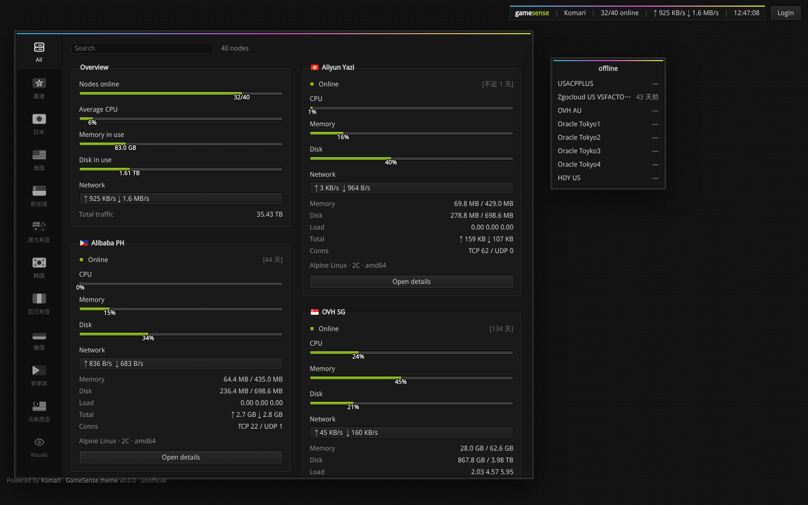

# GameSense

[Komari](https://github.com/komari-monitor/komari) 监控主题，skeet / gamesense 菜单风格。

- **菜单窗口**：层叠边框加彩虹顶线，可以拖动。左侧一列标签——全部节点、每个分组（或地区）、Visuals。
- **节点即分组框**：Online 复选框、CPU / 内存 / 硬盘 / 流量的细滑条、下拉框样式的实时网速，以及负载、累计流量、连接数。
- **水印**：右上角显示站点名、在线数、实时网速和时间。
- **离线列表**：有节点离线时出现的小窗口，仿观战者列表。
- **Visuals 标签**：菜单颜色、DPI 缩放、彩虹线、动效、背景点阵、列数、排序、隐藏离线节点、紧凑模式。每位访客的修改记在自己的浏览器里，没改过的项跟随后台的主题设置。
- 节点详情页含负载图表、延迟图表和三网回程。

## 安装

在 Komari 后台 → 主题 中上传 [Releases](https://github.com/wugan666/komari-theme-gamesense/releases) 里的 zip。

## 声明

非官方的同人风格作品，与 gamesense / skeet 没有任何关系，只是一个服务器监控页面的外观。

数据层与图表来自 [komari-theme-liquidbounce](https://github.com/wugan666/komari-theme-liquidbounce)（源自 Tokinx 的 komari-theme-emerald，MIT）。
